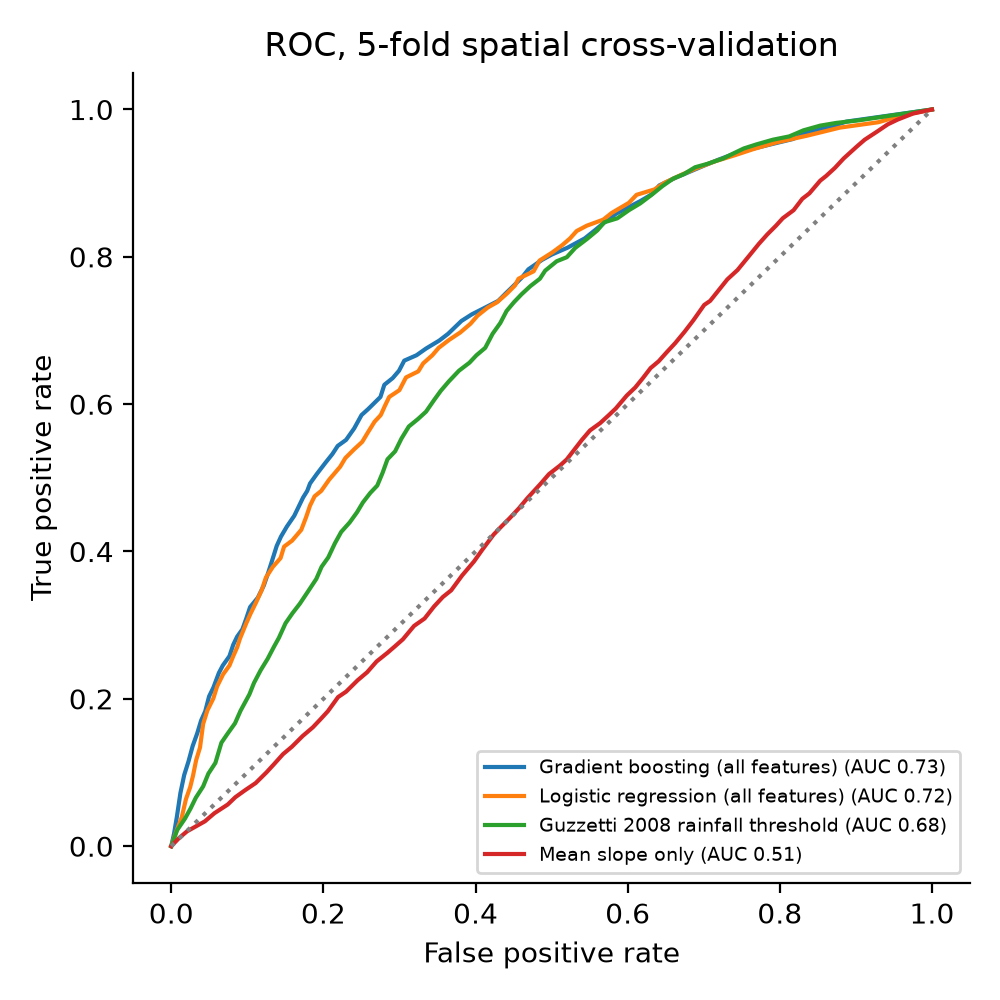
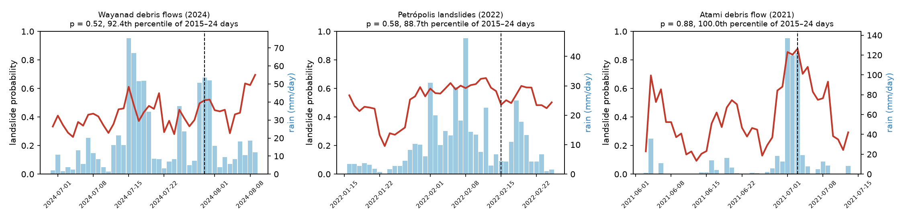

# SlopeWatch: explainable landslide early warning

[](https://github.com/Swapnil11801/landslide-early-warning/actions/workflows/tests.yml)

**Click any point on Earth and see an explainable landslide risk estimate for the past week and the 7-day forecast.
It runs entirely in your browser.**

🌍 **Live demo:** https://swapnil11801.github.io/landslide-early-warning/ &nbsp;·&nbsp;
📄 **Research note:** [research.html](https://swapnil11801.github.io/landslide-early-warning/research.html)



## What it does

1. **Terrain.** It reads global elevation tiles (AWS Terrain Tiles) and computes slope and local relief around the point in the browser.
2. **Rainfall.** It fetches the past 40 days of daily rainfall and the 7-day forecast (Open-Meteo).
3. **Model.** A gradient-boosted tree model trained on NASA's Global Landslide Catalog scores every day from a week ago to six days ahead.
4. **Explanation.** Each score is broken down into the contribution of each factor ("Why this score?").
5. **Scenarios.** A what-if slider shows how much extra rain the slope can take before the risk level changes.
6. **Area scan.** It scores a 10×10 grid over the visible map for today or any forecast day.
7. **Slope stability.** An infinite-slope factor-of-safety model shows the probability of failure over plausible soils.
   Sliders for cohesion, friction angle and soil depth let you explore the geomechanics.

It needs no backend and no API keys. The whole app is static files served by GitHub Pages.

## Results (5-fold spatial cross-validation)

| Model | ROC-AUC (95% CI) | vs temporal controls | vs spatial controls |
|---|---:|---:|---:|
| **Gradient boosting (all features)** | **0.73** (0.71–0.75) | 0.81 | 0.64 |
| Logistic regression (all features) | 0.72 (0.70–0.74) | 0.81 | 0.63 |
| Gradient boosting (rainfall only) | 0.67 (0.65–0.68) | 0.82 | 0.51 |
| Gradient boosting (terrain only) | 0.60 (0.58–0.61) | 0.50 | 0.70 |
| Guzzetti 2008 rainfall threshold | 0.68 (0.67–0.70) | 0.84 | 0.53 |
| Mean slope only | 0.51 (0.49–0.52) | 0.50 | 0.52 |
| Infinite slope: probability of failure | 0.52 (0.51–0.53) | 0.53 | 0.51 |
| Infinite slope: soil wetness only | 0.69 (0.67–0.70) | 0.84 | 0.53 |
| Infinite slope: rain-induced drop in FS | 0.64 (0.62–0.66) | 0.80 | 0.48 |

The dataset contains 1,097 rain-triggered landslides from 72 countries with
2,171 matched controls, split into 181 spatial blocks.
Confidence intervals come from a cluster bootstrap over spatial blocks.

- **Data-driven model.** Combining terrain and rainfall beats either alone, and it beats the Guzzetti (2008) global rainfall
  threshold on ROC-AUC. The difference is significant (95% CI +0.029 to +0.058).
  At the threshold's own false-alarm rate, however, both catch a similar share of landslides (81% vs
  80%).
- **Geomechanics.** An infinite-slope factor-of-safety model with a rainfall-driven water table and Monte Carlo
  reliability analysis (400 soil parameter sets) was also evaluated. Its water-table component alone matches the empirical
  threshold, but its probability of failure is close to chance. The model underestimates slope angles (median
  19.9° at landslide sites on the ~76 m DEM) and depends mainly on cohesion (rank correlation
  +0.81), which is unknown at global scale. Physically based models need local geotechnical data.
- **Out-of-sample case studies.** Three disasters after the training period were hindcast by scoring every day of
  2015–2024 at the affected place. Atami (Japan, 2021) was among the two highest-scoring days of the decade.
  Wayanad (India, 2024) and Petrópolis (Brazil, 2022) were elevated (92nd and 89th percentile) but not exceptional,
  because ERA5 rainfall misses intense local storms. Rainfall input is the main bottleneck.



The full methods, results and limitations are on the [Research page](https://swapnil11801.github.io/landslide-early-warning/research.html).

## Repository layout

```
web/                  static web app (GitHub Pages serves this folder)
  js/terrain.js       slope/relief from elevation tiles; mirrors research/src/terrain.py
  js/model.js         tree-ensemble inference + per-feature attributions
  js/weather.js       Open-Meteo rainfall + geocoding
  js/stability.js     infinite-slope FS + Monte Carlo P(FS<1); mirrors research/src/slope_stability.py
  model/              exported model, results, parity reference values
  tests.html          browser <-> Python parity tests (model, terrain, slope stability)
  tests/              the same checks for CI: Node (parity.test.mjs) and headless Chrome
research/
  src/build_dataset.py   case-control dataset from NASA GLC + terrain + ERA5 rainfall
  src/slope_stability.py infinite-slope stability, reliability and sensitivity analysis
  src/case_studies.py    out-of-sample hindcasts of three post-2017 disasters
  src/train.py           spatial CV, bootstrap CIs, baselines, physics, export to web/model/
  data/dataset.csv       the derived dataset (raw downloads are git-ignored)
  data/precip_30d.csv    the 30-day daily rainfall series behind each case
  figures/               figures for the paper
```

## Reproduce

```bash
pip install -r research/requirements.txt
python research/src/build_dataset.py   # ~1 h: downloads the catalog, elevation tiles, ERA5 rainfall (cached, resumable)
python research/src/train.py           # spatial CV + exports web/model/model.json and results.json
python research/src/case_studies.py    # out-of-sample hindcasts (Wayanad, Petrópolis, Atami)
python research/src/make_parity.py     # reference values for the parity tests
node --test web/tests/parity.test.mjs  # browser code vs Python (model, slope stability)
python -m http.server -d web 8000      # then open http://localhost:8000
```

## Deploy

Every push to `main` that touches `web/` is deployed to GitHub Pages automatically by
`.github/workflows/pages.yml`.

## Data sources and credits

- NASA Global Landslide Catalog: Kirschbaum et al. (2010, 2015). NASA Open Data Portal.
- ERA5 reanalysis (Copernicus Climate Change Service) and weather forecasts, via [Open-Meteo](https://open-meteo.com) (CC BY 4.0).
- Elevation: [AWS Terrain Tiles](https://registry.opendata.aws/terrain-tiles/), derived from SRTM, GMTED, ETOPO1 and national DEMs.
- Basemaps: OpenTopoMap, Esri World Imagery and CARTO / OpenStreetMap contributors.

## Disclaimer

This is a research prototype and **not** an official warning service. In an emergency, follow your local authorities.

## License

MIT. See [LICENSE](LICENSE). Cite with [CITATION.cff](CITATION.cff).
