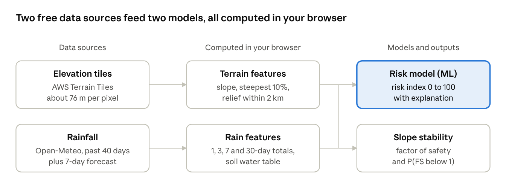

# SlopeWatch User Manual

Swapnil Ray · October 2026

## What SlopeWatch is

SlopeWatch estimates the risk of a rainfall-triggered landslide at any point on Earth for the past 7 days and the next 6, and explains every score. It runs entirely in a web browser, with no installation, account or API key.

For each point it combines three things:

- **Terrain:** slope and relief, computed in your browser from global elevation tiles.
- **Rainfall:** the past 40 days of daily rain plus the 7-day forecast, from Open-Meteo.
- **Two models:** a machine-learning model trained on 1,097 real landslides from NASA's Global Landslide Catalog, and a physically based slope-stability (factor of safety) model.



Both models use both feature sets. The risk model gives the main score; the slope-stability model explains the mechanics.

| Resource | Link |
| --- | --- |
| Live app | [swapnil11801.github.io/landslide-early-warning](https://swapnil11801.github.io/landslide-early-warning/) |
| Research page | [research.html](https://swapnil11801.github.io/landslide-early-warning/research.html) |
| Parity tests | [tests.html](https://swapnil11801.github.io/landslide-early-warning/tests.html) |
| Source code | [github.com/Swapnil11801/landslide-early-warning](https://github.com/Swapnil11801/landslide-early-warning) |

SlopeWatch is a research prototype by Swapnil Ray, not an official warning service.

## Quick start

You can get your first result in under a minute.

1. Open [the live app](https://swapnil11801.github.io/landslide-early-warning/) in any modern browser (Chrome, Edge, Firefox or Safari, on desktop or phone).
2. In the left panel, under **Try a place with a landslide history**, click a place such as **Wayanad, India**.
3. Wait 3–10 seconds while the panel shows its progress: loading the model, reading elevation, fetching rainfall, scoring.
4. Read the **risk gauge** at the top: a level (Low, Moderate, High or Very high) and an index from 0 to 100.
5. Scroll down for the past-week and 7-day forecast strip, rainfall chart, explanation, scenario slider and slope-stability panel.

To analyse another place, click anywhere on the map or use the search box. **✕ Clear** returns to the start screen.

## Choosing a location

There are four ways to pick a point. Hilly and mountainous areas give the most interesting results.

| Method | How | Notes |
| --- | --- | --- |
| Example places | Click a chip on the start screen, e.g. Darjeeling, Petrópolis, Oso, Amalfi Coast | Each has a recorded landslide history; the map flies to the place |
| Search | Type at least 2 letters of a town or region in the search box, then click a result or press Enter | Uses Open-Meteo geocoding; the place name is shown as the title |
| Click the map | Click any point on land | Title shows “Selected point” with coordinates and elevation |
| Direct link | Add `#latitude,longitude` to the address, e.g. `…/landslide-early-warning/#27.03,88.25` | Useful for sharing a specific site |

**Changing the map background.** Use the layers button (stacked squares, top right of the map) to switch between:

- **Terrain** (OpenTopoMap, the default): shows contours and relief.
- **Satellite** (Esri World Imagery): shows vegetation, scars and buildings.
- **Streets** (CARTO): shows towns and roads clearly.

The same menu turns the **past landslides** and **area scan** layers on and off.

## Reading the results

The panel is ordered from the headline answer to the detail behind it.

### Risk gauge

The gauge shows the machine-learning model's risk index (0–100) for the selected day, with its level and a one-line summary of terrain and recent rain.

| Level | Index | Share of real landslides in this band during testing |
| --- | --- | --- |
| Low | 0–24 | 17% |
| Moderate | 25–49 | 37% |
| High | 50–74 | 59% |
| Very high | 75–100 | 70% |

The index is a **relative** risk, not a probability. In testing, one case in three was a landslide by design; in reality landslides are far rarer.

### Past week + 7-day forecast

Fourteen coloured cells show the level for each day from 7 days ago to 6 days ahead. Hatched cells are forecast days. Click any cell to make it the selected day; every panel below updates. Hover a cell for its date, index and rainfall.

### Daily rainfall chart

Bars show daily rain (mm) for the last 30 days plus the forecast (lighter bars). The dashed line marks today and the outlined bar is the selected day. Four tiles below give the rain on that day and the 3-, 7- and 30-day totals.

### Why this score?

Each bar shows how much one input pushed the risk **up (red)** or **down (blue)** compared with an average place and day in the training data. The input's actual value is printed next to its name. Bars are sorted with the most influential first.

### Terrain

Four tiles summarise the ground: mean slope within 1 km, the steepest 10% of slopes within 1 km, relief (highest minus lowest point) within 2 km, and the slope at the exact point.

### Recorded history

This lists landslides in NASA's catalogue within 25 km (2007–2017), how many were fatal, and the four most recent. No entry does not mean no risk: the catalogue is built from news reports and misses remote areas.

## What-if scenarios

The **What if it rains more?** slider adds 0–300 mm of extra rain to the selected day and rescores it instantly.

- The gauge, rainfall chart (extra rain shown as an orange cap), explanation and slope-stability panel all update.
- The message under the slider gives the smallest extra rainfall, in 5 mm steps, that would raise the level, e.g. “About 45 mm more rain would raise the level to High.”
- If even 400 mm would not change the level, terrain is the limiting factor: the ground is too gentle for rain alone to make it risky.

Clicking another day resets the slider to zero. Use it to ask questions such as “Is tomorrow's forecast storm enough to matter here?”

## Slope stability panel

This panel applies classic geotechnical engineering: the infinite-slope **factor of safety (FS)**, the ratio of the forces holding the soil in place to the forces pulling it downhill. FS below 1 means the slope fails.

```math
FS = \frac{c'}{\gamma z \sin\beta \cos\beta} + \left(1 - \frac{m\,\gamma_w}{\gamma}\right)\frac{\tan\phi'}{\tan\beta}
```

Here c′ is cohesion, φ′ the friction angle, z the soil depth, β the slope angle (the steepest 10% of slopes within 1 km), γ and γw the unit weights of soil and water, and m the water-table height as a share of z. Rain from the last 30 days raises m.

| Element | What it shows | How to read it |
| --- | --- | --- |
| Factor of safety | FS for the selected day with the soil set on the sliders | ≥ 1.5 Stable · 1.3–1.5 Stable, low margin · 1.0–1.3 Marginally stable · < 1 Unstable |
| Water table | m as a percentage of soil depth | Rises after rain, drains over a few days |
| P(FS < 1) | Share of 400 realistic soils that would fail on this slope today | The probability of failure when soil strength is unknown |
| FS chart | FS for each of the 14 days; the red zone below 1.0 is failure | Hover a point for FS and P(fail); hollow points are forecast days |
| Soil sliders | Cohesion c′ (0–20 kPa), friction angle φ′ (20–45°), soil depth z (0.5–3 m) | Change the soil and watch FS respond; **Reset to typical soil** restores 5 kPa, 32°, 1.5 m |

Things to try: set cohesion to 0 to see how much stability comes from roots and cementation, or deepen the soil to see deeper slips become more likely.

**Use it to explain, not predict.** Testing showed P(FS < 1) on its own is barely better than chance. Global elevation data understates real slope angles and soil strength is unknown, so the machine-learning score remains the main risk estimate.

## Area scan and map layers

The **Area scan** box (bottom right of the map) scores a 10 × 10 grid of points over the visible map, so you can see which parts of a valley are riskiest.

1. Zoom in to at least level 10 (about 150 km across). The tool asks you to zoom in if you are further out.
2. Choose the day: **Today** or **In 1–6 days**.
3. Click **Scan visible area**. Progress appears under the button; a scan takes about 10–60 seconds.
4. Coloured squares appear, from green (Low) to red (Very high); stronger colour means a higher index. Water cells are skipped.
5. Hover a square for its level, index, mean slope and 3-day rain. Click it for the full analysis of its centre point.

A new scan replaces the previous one. Hide it from the layers menu (“Area scan”).

**Past landslides layer.** Dots mark all 11,033 events in NASA's Global Landslide Catalog. Larger dots are larger landslides; red dots caused deaths. Click a dot for its title, date, trigger, size and fatalities. Turn it off from the layers menu if the map gets crowded.

## Research page and parity tests

**[Research page](https://swapnil11801.github.io/landslide-early-warning/research.html)** (“Research” in the top bar) is the write-up of the project in the form of a short paper: abstract, introduction, data, methods, results, limitations, future work, references and a citation. Every number on it is loaded from the results file produced by the training code, so the text cannot drift from the data. Use its contents bar to jump to a section.

Key results it reports, from 5-fold spatial cross-validation:

| Method | ROC-AUC (95% CI) |
| --- | --- |
| SlopeWatch model (terrain + rain) | 0.73 (0.71–0.75) |
| Logistic regression (terrain + rain) | 0.72 (0.70–0.74) |
| Infinite slope: soil wetness only | 0.69 (0.67–0.70) |
| Guzzetti (2008) rainfall threshold | 0.68 (0.67–0.70) |
| Infinite slope: probability of failure | 0.52 (0.51–0.53) |

**[Parity tests](https://swapnil11801.github.io/landslide-early-warning/tests.html)** recompute 24 model predictions, terrain features for six places and slope-stability results for four cases in your browser and compare them with values from the Python research code. The page should end with “All 70 checks passed” after 30–90 seconds. The same checks also run automatically on GitHub after every push (the “Parity tests” badge in the README). They show that the app computes exactly what the research describes.

**Out-of-sample case studies** (section 4.5 of the research page) hindcast three disasters that happened after the 2017 end of the training data: Wayanad (India, 2024), Petrópolis (Brazil, 2022) and Atami (Japan, 2021). Every day from 2015 to 2024 is scored at each place, and the disaster day is ranked against all of them. Atami was among the two highest-scoring days of the decade; Wayanad (92nd percentile) and Petrópolis (89th) were elevated but not exceptional, because ERA5 rainfall misses intense local storms. Regenerate these numbers with `python research/src/case_studies.py`.

## Running locally and reproducing the research

You need Python 3.10 or newer, Git, an internet connection and about 1 GB of free disk space.

**Run the app on your computer** (no Python packages needed):

```bash
git clone https://github.com/Swapnil11801/landslide-early-warning.git
cd landslide-early-warning
python -m http.server 8000 -d web
```

Then open http://localhost:8000. The app still needs the internet for elevation tiles, rainfall and map backgrounds.

**Reproduce every number in the research:**

| Step | Command | Time | Produces |
| --- | --- | --- | --- |
| 1. Install packages | `pip install -r research/requirements.txt` | 2–5 min | numpy, pandas, scikit-learn, scipy, pillow, requests, matplotlib |
| 2. Build the dataset | `python research/src/build_dataset.py` | 1–2 h (rate-limited downloads; resumable) | `research/data/dataset.csv` from the NASA catalogue, elevation tiles and ERA5 rainfall |
| 3. Train and evaluate | `python research/src/train.py` | 10–20 min | `web/model/model.json`, `results.json`, `stability.json`, figures in `research/figures/` |
| 4. Parity reference values | `python research/src/make_parity.py` | 1–2 min | `web/model/parity.json` for the tests page |
| 5. Map layer of past landslides | `python research/src/export_events.py` | under 1 min | `web/data/events.json` |
| 6. Case studies | `python research/src/case_studies.py` | a few minutes | `web/model/case_studies.json`, `research/figures/case_studies.png` |

The derived dataset (`dataset.csv` and `precip_30d.csv`) is already in the repository, so you can skip step 2 and go straight to step 3. Downloads are cached in `research/data/`; if step 2 stops (for example, the rainfall service limits requests), run it again and it continues where it left off.

On Windows, if `train.py` fails with a `UnicodeEncodeError`, run `set PYTHONIOENCODING=utf-8` first.

To run the parity checks from the command line: `node --test web/tests/parity.test.mjs`.

## Repository layout and deployment

Any change pushed to the `main` branch that touches the `web/` folder goes live automatically within about a minute, through GitHub Actions and GitHub Pages.

| Folder or file | Contains |
| --- | --- |
| `web/` | The app: `index.html`, `research.html`, `tests.html`, styles, JavaScript and the exported model files |
| `web/js/` | `app.js` (interface), `terrain.js` (slope from elevation tiles), `weather.js` (rainfall, search), `model.js` (risk model and explanations), `stability.js` (factor of safety), `research.js` (research page) |
| `web/tests/` | Command-line and headless-browser runners for the parity checks |
| `research/src/` | Python pipeline: dataset build, training, slope stability, parity values, map layer export, case studies |
| `research/data/` | The derived dataset; raw downloads are cached here and not committed |
| `research/figures/` | Figures for papers and presentations |
| `.github/workflows/` | Automatic deployment (`pages.yml`) and parity tests (`tests.yml`) |

If you change the Python model, re-run `train.py` and `make_parity.py`, open the tests page locally to confirm all checks pass, then push.

## Limitations and responsible use

SlopeWatch is a research prototype. **It is not an official warning, and nobody should make safety decisions based on it.** In an emergency, follow local authorities and national meteorological or geological services.

| Limitation | Effect on results |
| --- | --- |
| Moderate accuracy (ROC-AUC 0.73) | Useful for ranking places and days by risk; many real landslides still score Low or Moderate |
| Risk index is relative, not a probability | An index of 70 does not mean a 70% chance of a landslide |
| News-based training data (2007–2017) | Over-represents populated, English-reported regions; the United States is 26% of training landslides |
| Coarse rainfall (ERA5, ~25–30 km) | Short, local cloudbursts that trigger debris flows can be missed |
| Forecast rain in the app vs reanalysis rain in training | Scores for today and future days may be shifted slightly |
| Elevation at ~76 m per pixel | Small, steep slopes, road cuts and cliffs look gentler than they are |
| Missing factors | Geology, soil type, land cover, deforestation, construction and earthquakes are not modelled |
| Slope-stability model uses textbook soil values | Explains the mechanism; on its own it predicts landslides barely better than chance |

SlopeWatch is an independent research prototype with open code and an honest evaluation, not a validated warning system.

## Troubleshooting and FAQ

| Problem | Cause | Fix |
| --- | --- | --- |
| “That point is in water” | The point's elevation is 0 m or below | Click a point on land |
| “Weather service error (429)” | Too many rainfall requests in a short time, often after several area scans | Wait 1–2 minutes and try again |
| “Elevation tile … failed” | Network problem or a blocked connection to Amazon S3 | Check your internet connection; try another network or browser |
| Loading never finishes | A slow or interrupted download | Click the point again or reload the page |
| Map background is grey or patchy | Map tiles are still loading from the provider | Wait a few seconds, or switch background in the layers menu |
| Area scan says “Zoom in” | The view is wider than zoom level 10 | Zoom in until the view is about 150 km across or less |
| Search shows “No matches” | The place name is not in the geocoding database | Try a nearby town or the English spelling, or click the map |
| Tests page shows mismatches | The model files and the JavaScript are out of step | Re-run `train.py` and `make_parity.py` |

**Why did today's score change since this morning?** The rainfall forecast updates several times a day, so forecast days, and sometimes today, are rescored.

**Why is a place with past landslides rated Low?** The score reflects current rain. A landslide-prone slope is Low on a dry day; check the history card and the what-if slider.

**Does it work offline?** No. It needs the internet for elevation tiles, rainfall data and map backgrounds.

**Is my location sent anywhere?** SlopeWatch has no server of its own and stores nothing. The coordinates you analyse go to Open-Meteo (rainfall and search) and Amazon S3 (elevation tiles), and the map providers (OpenTopoMap, Esri, CARTO) receive requests for the map area you view. Fonts and the map library load from Google Fonts and cdnjs.
